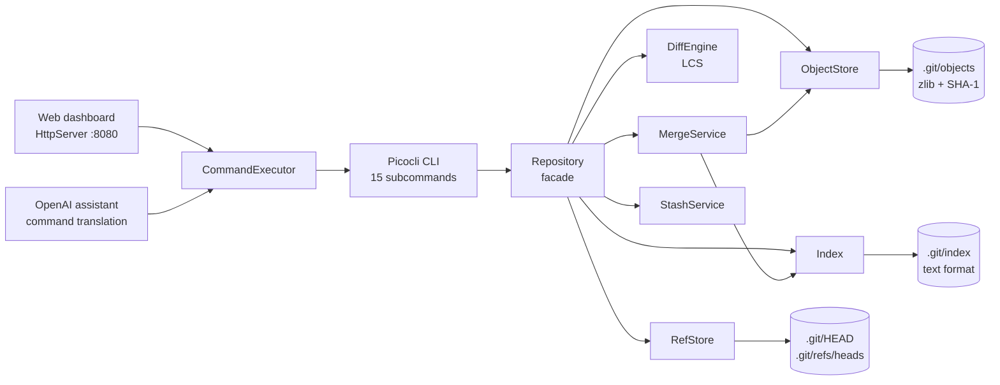

# mygit

**A Git subset built from scratch in Java 21 — real SHA-1/zlib objects, a staging index, branches, merges, stash, and an OpenAI-powered command assistant.**


`mygit` was built during a 24-hour hackathon (Hacksplosion 2026, per the project's revision guide) to make Git's internals inspectable. It implements a useful local workflow in about 3,600 lines of Java across 33 source files, and it stores objects in the same on-disk format real Git uses.

---

## What it does

- **Real Git object storage.** Blobs, trees, and commits are written as `SHA-1("<type> <length>\0<content>")`, zlib-compressed, and stored under `.git/objects/ab/cdef...`. Blob hashes match real Git byte-for-byte for the same input.
- **Staging, commits, and history.** A flat text index tracks staged paths; `commit` builds recursive tree objects and stores a commit with parent, author, and message. `log`, `status`, and `cat-file` read the history back.
- **Branches and merging.** Branch refs live in `.git/refs/heads`. `merge` supports fast-forwards and a whole-file three-way merge with conflict markers and two-parent merge commits.
- **LCS line diffs.** `diff`, `diff --cached`, `diff --HEAD`, and branch-to-branch diffs use a longest-common-subsequence table and emit unified-style output.
- **Recovery helpers.** `stash` / `stash pop` / `stash list`, `reset --soft|--mixed|--hard`, `restore --staged`, and basic `.gitignore` filtering.
- **Three ways to drive it.** A Picocli CLI with 15 subcommands, a local web dashboard, and an OpenAI natural-language assistant that proposes a command, explains it, and asks for confirmation before running it, with extra warnings for destructive operations.

---

## Quickstart

**Requirements:** JDK 21+ and Maven to build.

```bash
git clone https://github.com/DIVESHvalecha/MyGit.git
cd MyGit
mvn clean package
java -jar target/MyGit-1.0-SNAPSHOT.jar --help
```

<!-- [UNVERIFIED] The `mvn clean package` command was not executed during the README review because Maven was not installed in that environment. The existing `target/MyGit-1.0-SNAPSHOT.jar` was used to verify the CLI behavior below. -->

Then try it in a scratch directory:

```bash
JAR="$PWD/target/MyGit-1.0-SNAPSHOT.jar"
mkdir ~/mygit-demo && cd ~/mygit-demo

java -jar "$JAR" init .
printf 'hello\n' > hello.txt
java -jar "$JAR" add hello.txt
java -jar "$JAR" commit -m "first commit" -a "Your Name <you@example.com>"
java -jar "$JAR" log
java -jar "$JAR" status
```

The repository currently tracks a prebuilt jar at `target/MyGit-1.0-SNAPSHOT.jar`, so you can run the CLI before building if you only want to try it. Building from source is still recommended.

---

## Usage examples

### Track a file and commit it

```bash
java -jar "$JAR" init .
java -jar "$JAR" add hello.txt
java -jar "$JAR" commit -m "first commit" -a "Your Name <you@example.com>"
java -jar "$JAR" log
```

The commit prints a short summary such as `[main <short-sha>] first commit`. `log` walks parent links from `HEAD` and prints the full SHA, author line, date line, and message.

### Branch, merge, and resolve a conflict

```bash
java -jar "$JAR" checkout -b feature
# edit a file, then:
java -jar "$JAR" add .
java -jar "$JAR" commit -m "feature work" -a "Your Name <you@example.com>"
java -jar "$JAR" checkout main
java -jar "$JAR" merge feature
```

A fast-forward prints `Fast-forward` and `Merged 'feature' into 'main'.` If both branches changed the same file, the merge writes whole-file conflict markers and stops. The conflicted file contains the current branch's version, a separator line, and the incoming branch's version, wrapped by three marker lines:

| Marker line | Meaning |
|---|---|
| A line of seven `<` characters, then the current branch name | start of the current branch's content |
| A line of seven `=` characters | separator between the two versions |
| A line of seven `>` characters, then the incoming branch name | start of the incoming branch's content |

Fix the file, stage it, and commit. Note that the follow-up commit is a normal single-parent commit; `MERGE_HEAD` is not implemented.

### Stash work in progress

```bash
java -jar "$JAR" stash
java -jar "$JAR" stash list
java -jar "$JAR" stash pop
```

`stash` saves a WIP commit at `.git/refs/stash`, resets the working tree and index to `HEAD`, and `stash pop` restores the saved files. Only one stash entry is supported.

### Ask the AI assistant

```bash
export OPENAI_API_KEY="..."   # or pass --key
java -jar "$JAR" ai
```

```text
mygit ai> commit my changes with a message about the readme
```

The assistant prints a proposed `mygit` command, a one-line explanation, and asks `execute? (y/n)`. It warns before `--hard`, `--mixed`, branch deletion, and other destructive commands. The model is constrained to the command list in `OpenAIClient.SYSTEM_PROMPT`; it does not have arbitrary shell access.

### Open the local dashboard

```bash
java -jar "$JAR" --web
# http://localhost:8080
```

The dashboard serves an HTML command console and a `POST /run` endpoint that executes submitted `mygit` commands. It has **no authentication**, binds port 8080, allows cross-origin requests, and can run destructive commands. Run it locally only; do not expose it to a network.

---

## How it works

`mygit` follows Git's core separation of concerns:

1. **Objects** — immutable blobs, trees, and commits live in `.git/objects`, addressed by SHA-1.
2. **Index** — `.git/index` records the staged path-to-blob mapping. This project uses a readable text format (`<sha>  <path>`), not Git's binary index.
3. **Refs** — `.git/HEAD` points at a branch; `.git/refs/heads/<name>` contains the branch's commit SHA.
4. **Facade** — `Repository` coordinates the object store, index, refs, and the merge/reset/restore/stash services.
5. **Interfaces** — Picocli commands call the facade; the AI assistant and web dashboard call the CLI through `CommandExecutor`.



### Object format

```text
<type> <byte-length>\0<content>
```

For example, a blob containing `hello\n` becomes `blob 6\0hello\n`. The SHA-1 of those bytes is the object ID. When writing, the same bytes are zlib-compressed and stored at `.git/objects/<first 2 hex>/<remaining 38 hex>`.

### Merge model

`MergeService` first checks whether the target commit is an ancestor of the current commit (fast-forward). Otherwise it finds the common ancestor by walking parent chains, compares each path by blob SHA, and applies six whole-file cases:

1. same blob on both sides;
2. added only on the incoming side;
3. added only on the current side;
4. changed only on the incoming side;
5. changed only on the current side;
6. changed on both sides → conflict.

This is intentionally **file-level**, not line-level. The LCS engine is used for diffs, not to merge individual lines, so two branches editing different lines of the same file still conflict.

---

## Command reference

| Command | What it does | Example |
|---|---|---|
| `init [dir]` | Create `.git/objects`, `HEAD`, and `refs/heads` | `mygit init .` |
| `add <files...>` | Hash files and stage them; `.` walks the tree | `mygit add .` |
| `commit -m <msg> [-a <author>]` | Write a tree and commit, then advance the branch | `mygit commit -m "fix" -a "A <a@b.c>"` |
| `log` | Walk parent links from `HEAD` | `mygit log` |
| `status` | Compare index vs commit and disk vs index | `mygit status` |
| `hash-object [-w] <file>` | Print a blob SHA; `-w` writes the object | `mygit hash-object hello.txt` |
| `cat-file -p\|-t <sha>` | Pretty-print or type an object | `mygit cat-file -p <sha>` |
| `branch [name] [-d]` | List, create, or delete a branch | `mygit branch feature` |
| `checkout [-b] <branch>` | Switch branches, optionally creating one | `mygit checkout -b feature` |
| `diff [--cached\|--HEAD\|a..b]` | Show line diffs | `mygit diff --cached` |
| `merge <branch>` | Fast-forward or three-way merge | `mygit merge feature` |
| `restore --staged <files...>` | Unstage files | `mygit restore --staged hello.txt` |
| `reset [--soft\|--mixed\|--hard] [target]` | Move `HEAD`; defaults to `--mixed HEAD` | `mygit reset --hard HEAD~1` |
| `stash [pop\|list]` | Save, restore, or list one WIP stash | `mygit stash pop` |
| `ai [--key <key>] [--dir <dir>]` | Natural-language command assistant | `mygit ai` |
| `--web` | Start the local dashboard on port 8080 | `mygit --web` |

`--web` is handled in `Main` before Picocli parses subcommands.

---

## Configuration

`mygit` has no config file and does not read `.env`. The only runtime configuration is the OpenAI key and two AI options.

| Variable / option | Purpose | Default | Required |
|---|---|---|---|
| `OPENAI_API_KEY` | API key used by `mygit ai` | none | Required for AI only |
| `--key`, `-k` | Pass the OpenAI key directly instead of using the environment | none | Alternative to the env var |
| `--dir`, `-d` | Working directory used by the AI assistant | `.` | No |
| `--web` | Start the web dashboard | off | No |
| Port `8080` | Dashboard listen port | `8080` | No; not configurable |

The web dashboard has no authentication or access control. The AI client uses OpenAI's `gpt-4o-mini` chat-completions endpoint and has no explicit timeout or retry policy.

---

## Verified behavior and compatibility

The following was checked by running the existing jar in isolated temporary directories:

- **Blob IDs match real Git.** For a file containing `hello\n`, both `mygit hash-object` and `git hash-object` return `ce013625030ba8dba906f756967f9e9ca394464a`.
- **Real Git can read mygit objects.** After `mygit init`, `add`, and `commit`, `git log --oneline` shows the commit and `git cat-file -p HEAD` prints its tree, author, and message.
- **The index is not compatible.** Real Git cannot operate on a mygit working tree: `git fsck --full` reports `fatal: index file corrupt` because `.git/index` is the project's text format, not Git's binary index.
- **Merge conflicts are whole-file.** Diverged branches that edit the same file produce standard conflict-marker lines (seven `<`, seven `=`, and seven `>` characters) around the complete versions.
- **Stash is single-entry.** `stash list` prints one `stash@{0}` entry; there is no stack.
- **The dashboard responds.** `GET /` returns HTTP 200; `POST /run` with `{"command":"mygit --version"}` returns `{"output":"mygit 1.0"}`.

---

## Project layout

```text
MyGit/
├── pom.xml
├── src/main/java/org/divesh/
│   ├── Main.java              # Picocli root command + --web entry point
│   ├── commands/              # one command class per subcommand
│   ├── core/
│   │   ├── ObjectStore.java   # SHA-1 + zlib object read/write
│   │   ├── Repository.java    # facade: add, commit, log, status, checkout...
│   │   ├── Index.java         # text staging index
│   │   ├── RefStore.java      # HEAD and branch refs
│   │   ├── MergeService.java  # fast-forward + whole-file three-way merge
│   │   ├── DiffEngine.java    # LCS line diff
│   │   ├── StashService.java  # single stash entry
│   │   ├── ResetService.java
│   │   ├── RestoreService.java
│   │   └── GitIgnoreService.java
│   ├── agent/                 # OpenAI client, command executor, REPL
│   └── web/                   # JDK HttpServer dashboard
└── target/                    # build output (tracked in the current repo)
```

There is no `src/test` content and no `.github/workflows`; this is the first README in the repository. JUnit 5 and AssertJ are declared in `pom.xml` but no test sources are tracked.

---
## Author

Built by [Divesh Valecha](https://github.com/DIVESHvalecha).